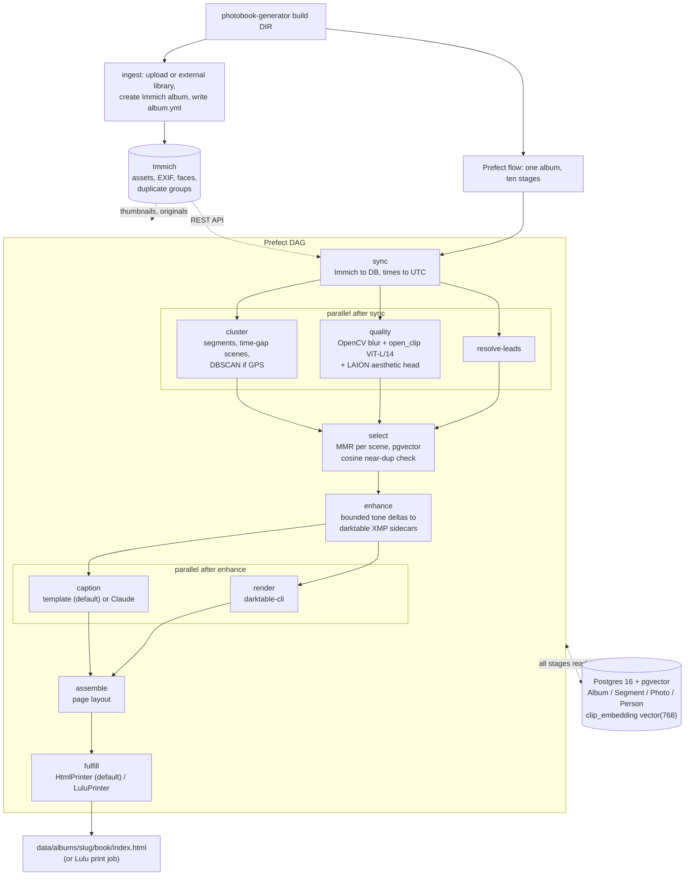
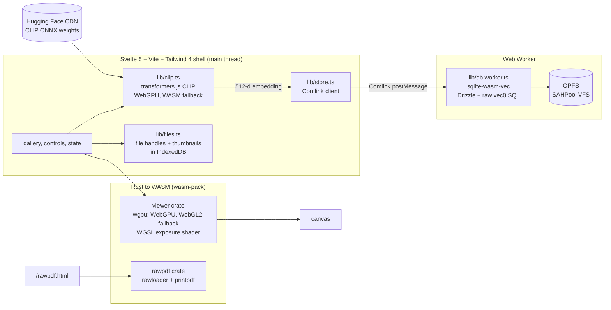

# photobook-transformer

Turn a raw dump of photos into a curated, enhanced, captioned, print-ready photo book with
minimal manual work. It is not tied to any event type: a trip, a wedding or a baby's first year
is just an *album* (an `Album` with optional, named `Segment`s).

It is a monorepo with two sibling projects at very different maturity:

| Dir | What it is | Maturity | Stack |
| --- | --- | --- | --- |
| **[`pipeline/`](./pipeline/)** | The batch pipeline that turns a raw photo dump into a curated, enhanced, captioned, print-ready book. | **Mature product.** The build order (steps 0-16) and follow-on playbooks through step 43 are done and merged; [`progress.md`](./knowledge/build/progress.md) lists what is still deferred. | Python 3.14, `uv`, Prefect, SQLAlchemy + Postgres/pgvector, open_clip |
| **[`rust-client/`](./rust-client/)** | A greenfield spike testing how much of the analysis/select stack can run **client-side in the browser**. First non-Python stack. | **Spike.** Deliberately outside the Python gate and not wired into Postgres or Immich. | Svelte + shadcn-svelte tokens, Rust to WASM (wgpu), sqlite-vec in a Worker on OPFS, transformers.js |

## Why it exists

Making a photo book from thousands of unsorted pictures is mostly culling, ordering and fixing
tone, not design. The pipeline automates that: dedupe, score, cluster into scenes, pick the best
frame per scene (keeping people and "lead" subjects covered), apply gentle tone corrections, add
captions, lay out pages. The rust-client asks the follow-up question: could the analysis half run
in the browser, so photos never leave the user's machine?

## What to look at (if you have five minutes)

- **Stage-as-task design** - every stage is a class that is its own Prefect task, constructed with
  `album_id` and a `session_factory`; Prefect is imported in only two modules.
  [`flow/stages/base.py`](./pipeline/src/album/flow/stages/base.py),
  [`flow/_flow.py`](./pipeline/src/album/flow/_flow.py).
- **DAG with explicit concurrency invariants** - two fan-out groups, commit before fan-out,
  `expire_all()` after join, one session per worker thread.
  [`pipeline-execution.md`](./knowledge/foundations/pipeline-execution.md).
- **Diversity-aware selection** - MMR per scene with a pgvector cosine near-duplicate cutoff
  (tunable per album), plus people, lead-face and star-rating boosts.
  [`flow/stages/select.py`](./pipeline/src/album/flow/stages/select.py),
  [`db/similarity.py`](./pipeline/src/album/db/similarity.py).
- **Bounded, classical enhancement** - tone deltas are range-limited numbers estimated with CV and
  written as darktable's real XMP history stack; nothing generates pixels.
  [`flow/stages/enhance.py`](./pipeline/src/album/flow/stages/enhance.py),
  [`analysis/tone_estimator.py`](./pipeline/src/album/analysis/tone_estimator.py).
- **Offline by default, LLM opt-in** - tone and captions need no API key; Claude is a per-run
  `--captioner claude` upgrade behind a `Captioner` protocol.
  [`analysis/captioner.py`](./pipeline/src/album/analysis/captioner.py).
- **Enforced engineering discipline** - ruff, basedpyright, a xenon complexity gate at grade A, pytest
  with real Postgres/darktable containers, a pre-push hook that runs the full gate, and a genericity
  test that loads a structurally different shipped album.
- **Browser data layer** - sqlite-vec (`vec0`) compiled to WASM, run in a Comlink worker, persisted on
  OPFS. [`rust-client/src/lib/db.worker.ts`](./rust-client/src/lib/db.worker.ts).
- **Rust/wgpu viewer** - one codebase over WebGPU with a WebGL2 fallback.
  [`rust-client/viewer/src/lib.rs`](./rust-client/viewer/src/lib.rs).

## Tech stack and why

Rationale is recorded in [`knowledge/reference/tech-stack.md`](./knowledge/reference/tech-stack.md) and
[`knowledge/foundations/architecture.md`](./knowledge/foundations/architecture.md).

| Concern | Choice | Why (from the docs and code) |
| --- | --- | --- |
| Photo storage, ingest, dedup, faces | Immich (self-hosted; `IMMICH_VERSION=v3.0.3` in `pipeline/.env.example`) | Reuses its import, duplicate detection and face recognition; the pipeline touches it only at `sync` and when it needs image bytes. |
| Pipeline state | Postgres + `pgvector` via SQLAlchemy, alembic migrations | Resumable per-photo columns (`NULL` = stage not run yet); indexed CLIP similarity for `select`; concurrent writers under Prefect fan-out (SQLite's single writer fights that). Pure-logic tests still run on in-memory SQLite. |
| Orchestration | Prefect 3 (local server) | Retries, per-photo failure isolation, run history. |
| Embeddings and scoring | `open_clip` ViT-L/14 (768-d) plus the LAION aesthetic head | One CLIP forward serves both the embedding and the aesthetic score. Optional `scoring` extra so base installs stay free of torch. |
| Tone rendering | `darktable-cli` driven by XMP sidecars | Real RAW-capable development; shipped in the Docker image. |
| LLM (optional) | PydanticAI with Claude | Validated, bounded structured output; testable with `TestModel`. |
| Output | Jinja2 templates; `HtmlPrinter` (default) or `LuluPrinter` (opt-in, WeasyPrint PDF to the Lulu Print API) | The printer is a Strategy seam. |
| Tooling | uv, ruff, basedpyright, radon/xenon, pytest, testcontainers, poethepoet, pre-commit | Typed, complexity-gated, test-first. |
| Browser | Svelte 5, Vite, Tailwind 4; Rust to WASM with wgpu; `sqlite-wasm-vec` with Drizzle and Comlink; `@huggingface/transformers` | The model stays in JS, where transformers.js packages it; pixels (wgpu) and data (vec0) are separate, swappable pieces. |

## Architecture

### pipeline/



Immich's public API exposes no CLIP embeddings, so `quality` computes its own with `open_clip`; that is
why `photos.clip_embedding` is `vector(768)` ([`db/models.py`](./pipeline/src/album/db/models.py)). Every
stage is scoped by `album_id` and idempotent, so a crashed run can be re-run.

### rust-client/



The browser client defaults to CLIP ViT-B/32 (512-d) for a fast first load; `lib/clip.ts` notes how to
switch to ViT-L/14 for 768-d parity with the server column. Full-resolution images are never stored in
SQLite; it holds embeddings, a content hash and the file name. Note that
[`rust-client/README.md`](./rust-client/README.md) still describes the earlier in-Rust cosine KNN (a `core/`
crate); that crate was retired in favour of sqlite-vec (see `rust-client/Cargo.toml` and commits
`6ada5bd`, `d863dcb`).

## Pipeline stages

Per-stage detail: [`knowledge/stages/`](./knowledge/stages/index.md).

| Stage | What it does |
| --- | --- |
| `sync` | Pull the Immich album's assets, EXIF, faces and duplicate groups into Postgres; normalize capture times to UTC. Idempotent, keyed on Immich asset id. |
| `resolve-leads` | Map `album.yml` priority subjects (the couple, the baby) to Immich people. |
| `quality` | Laplacian-variance blur (OpenCV), CLIP embedding and LAION aesthetic score. |
| `cluster` | Assign photos to segments by timestamp; split scenes on time gaps (default 90 min), refined by DBSCAN when every photo has GPS. Works with no segments and no GPS. |
| `select` | Best-of-scene via MMR with near-duplicate suppression; boosts for groups, leads and star ratings; leads are guaranteed coverage. |
| `enhance` | Estimate bounded exposure, white-balance, shadow and highlight deltas; reconcile across cameras; write XMP sidecars. |
| `render` | `darktable-cli` over the sidecars into corrected JPEGs. |
| `caption` | Template captions from who, where and when (default), or Claude. |
| `assemble` | Page layout (1/2/3-up cycle, a section page per segment). Produces layout only. |
| `fulfill` | Deliver through a `Printer`: a static HTML book, or a Lulu print order. |

## How to run

### pipeline/ (Python 3.14, uv)

Prerequisites: Python 3.14 (`pipeline/.python-version`), [`uv`](https://docs.astral.sh/uv/), Docker. A full
run needs a live Immich, Postgres and Prefect, which `docker compose` provides.

```sh
cd pipeline
uv sync --extra scoring              # torch + open_clip (large); plain `uv sync` is enough for dev and tests
uv run pre-commit install
cp .env.example .env
uv run poe fetch-aesthetic-weights   # one-time, needs network; required for real aesthetic scoring
uv run poe up                        # docker compose up --build: Immich + Postgres/pgvector + Prefect
uv run poe migrate                   # alembic upgrade head, once the stack is up
```

Open `http://localhost:2283`, create the Immich admin account, create an API key and set it as
`IMMICH__API_KEY` in `.env`. Then:

```sh
uv run photobook-generator build ./path/to/photos             # ingest + full run
uv run photobook-generator build --no-ingest --album <slug>   # re-run an existing album.yml
```

The book lands at `data/albums/<slug>/book/index.html`. The default run is fully offline;
`ANTHROPIC_API_KEY` is only for `--captioner claude`. `build` also supports `--manifest` (a tree of albums
into N books), `--ingest-mode external` (scan photos in place), `--source-document` (derive segments from a
PDF itinerary), `--slug`, `--title`, `--timezone` and `--force`. More, including a Docker variant (the `app`
image bundles `darktable-cli`), is in [`pipeline/README.md`](./pipeline/README.md) and the
[`knowledge/`](./knowledge/index.md) bundle. Without the `scoring` extra the flow falls back to a
placeholder scorer with a warning, so curation is not real.

### rust-client/ (Node 22, Rust, wasm-pack)

Prerequisites: Node 22 (`rust-client/.nvmrc`), a Rust toolchain (version not pinned in the repo) with
`rustup target add wasm32-unknown-unknown`, `wasm-pack`, and a WebGPU-capable browser (Chrome/Edge, Safari
18+) for GPU CLIP; otherwise it falls back to much slower WASM.

```sh
cd rust-client
nvm use                # Node 22 from .nvmrc
npm install
npm run wasm           # required after clone: builds the Rust crates into src/wasm/ (slow the first time)
npm run dev            # http://localhost:5173 ; RAW to PDF proof at /rawpdf.html
```

Drop images on the gallery: each is embedded with CLIP, stored in sqlite-vec and shown. Click one to open
the wgpu viewer, drag **Exposure**, or use **Find similar** (vec0 KNN). Model weights are downloaded from
the Hugging Face CDN on first use.

## Tests

- **pipeline** - `cd pipeline && uv run poe check` is the commit/push gate: `ruff check`,
  `ruff format --check`, `basedpyright`, `xenon` (complexity A), then `pytest`. Test files mirror
  `src/album/` (stages, Immich client via `respx`, printers, CLI, config, manifest, a genericity test, a
  pgvector suite against a real container).
  - `uv run poe test-unit` skips tests marked `integration` (they need Docker via testcontainers and a real
    `darktable-cli`); `uv run poe test-integration` runs only them.
  - Opt-in and not in `check`: `uv run poe test-scoring` (real ViT-L/14 scorer; needs the extra and the
    weights) and `uv run poe test-immich-ml` (offline Immich ML stack).
- **rust-client** - no automated tests. The only gate is `npm run check` (svelte-check plus `tsc`).

No coverage figures are published for either project.

## Notable engineering challenges (visible in code and history)

- **XMP sidecars that darktable ignored.** `enhance` first wrote flat `darktable:exposure="..."` attributes,
  which `darktable-cli` silently ignores, so no render applied any correction. A real-darktable integration
  test (commit `2f79aac`) exposed it; the fix emits darktable's hex-encoded history-stack params, pinned to
  darktable 5.0.1 and guarded by that test.
- **Concurrency race found in review.** Running `enhance` and `caption` fully concurrently let both fire the
  shared analysis and race on the same row; the flow now joins `enhance` before submitting `render` and
  `caption` (commit `e7818ba`).
- **Wrong media type sent to the LLM.** Immich serves thumbnails as WebP, but the captioner declared JPEG and
  the API rejected the request; the type is now sniffed from magic bytes (commit `1d9fe4f`).
- **Heavy ML kept optional.** torch and open_clip are an opt-in extra and the scorer module imports without
  them; in Docker, torch is pinned to the CPU index to avoid about 5 GB of unusable CUDA libraries
  (`pyproject.toml`, `Dockerfile`).
- **wgpu colour and limits.** Chrome's WebGPU canvas has no sRGB surface format, so the viewer does sRGB
  encode/decode in the shader to fix a too-dark image (commit `0d1e171`); wgpu 23+ is required because 22
  requests a limit current Chrome removed.
- **OPFS in a worker.** SAHPool takes exclusive handles, so a reload could race a navigated-away worker and
  silently fall back to memory; the worker is terminated on `pagehide`, with a bounded retry (commit
  `d863dcb`).
- **RAW in the browser.** `rawloader` plus `printpdf` in WASM turn a camera RAW into a PDF entirely
  client-side (commit `15aa414`). The crude develop step does not give correct colour for every RAW (see
  Demo notes).

## Demo

Screenshots, a short video, run transcripts and the scripts that produced them are kept outside this
repo. The demo photos are 26 CC0 images from Wikimedia Commons (an Ishigaki trip by user
"Syced") plus CC0 RAW samples from raw.pixls.us; no personal photos.

### Demo notes (what was real and what was substituted)

- **The pipeline run was real except for Immich.** The actual 10-stage Prefect flow ran against Postgres 16
  with pgvector, a Prefect 3 server, real `open_clip` ViT-L/14 plus LAION scoring (CPU), real `darktable-cli`
  5.0.1 and the real `HtmlPrinter`. 25 of 26 photos were selected; one near-duplicate was dropped by CLIP
  similarity.
- **Immich was replaced by a local-folder stand-in**, injected through the `Pipeline(immich_client=...)` seam
  with no repo code patched, because a real Immich needs an admin account and API key created in its web UI.
  Not exercised: upload and album creation (the `build` ingest phase), faces, `lead_faces`, Immich duplicate
  groups, reverse geocoding, Immich's ML thumbnails, external-library mode.
- **Also not exercised:** Lulu ordering (the print PDF came from calling the printer's WeasyPrint renderer
  directly; no Lulu API call) and `--captioner claude` (default template captions and classical tone were
  used).
- **Container setup:** the existing local `app` image, built earlier from this repo's Dockerfile with an
  identical `uv.lock`, was run with the current `pipeline/src` and `templates` bind-mounted, because registry
  pulls hung on the demo machine and the image could not be rebuilt. Host darktable on that Mac was broken,
  which is why render ran inside the image.
- **The browser capture used a local mirror of the CLIP files.** Hugging Face answers headless Chromium with an
  AWS WAF CAPTCHA, which was not bypassed. The same three CLIP files were downloaded separately and served
  locally, and requests to Hugging Face were redirected to them. App code was unchanged. A live, headed run
  against the real CDN was not captured.
- **RAW to PDF limits.** For the Olympus XZ-1 `.orf` sample, `rawloader` yields no white-balance coefficients,
  so the spike's crude develop produces a green image; an iPhone DNG gives correct colour. Headless Chromium
  has no PDF viewer, so the PDF preview pane is blank in captures even though the PDF is valid.
- **Gates in the demo session** (host, this branch): lint, type check and the complexity gate were clean and
  `poe test-unit` passed (435 passed, 3 skipped, 39 integration tests deselected). Integration tests were not
  run.

## Docs and conventions

[`AGENTS.md`](./AGENTS.md) is the operational summary for coding agents; the [`knowledge/`](./knowledge/index.md)
bundle (Open Knowledge Format) is the detail and the single source of truth: domain model, architecture,
stages, data model, build order and process. Design brief for the spike:
[`knowledge/build/drafts/rust-client.md`](./knowledge/build/drafts/rust-client.md).

## Built with

<!-- TODO(owner): state how this project was built (manual vs AI-assisted) and in what proportion.
     Facts visible in the repo, for reference only: AGENTS.md and knowledge/process/ describe an
     agent-driven per-step workflow (sub-agent review, test-first, squash merge), and some commits carry
     Co-Authored-By trailers. This README does not claim a split. -->

**TODO(owner):** manual-vs-AI attribution for this project goes here.
