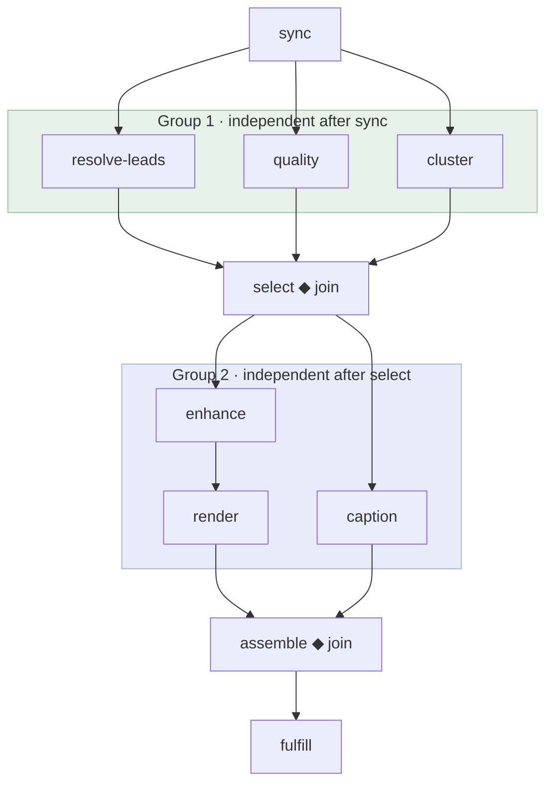

# Pipeline execution shape

> **Status (updated 2026-07-16): implemented, then restructured.** The fan-out
> DAG that the sections below propose as a "change"/"sketch" was applied in build
> [step 25](/build/progress.md) and later restructured by a refactor. In the
> current code each stage **co-locates its own Prefect `@task`** in
> `flow/stages/*.py`; the shared-session-vs-own-session commit wrappers live in
> `flow/_tasks.py`; and the single `@flow` is produced by the **class-based
> `Pipeline.flow()`** factory in `flow/_flow.py`. Everywhere below, read
> **`flow.py`** as **`flow/_flow.py`**, and the "as it runs today — a linear
> chain" reading as the *original* design the DAG replaced. The
> dependency-graph analysis and the two invariants (commit-before-fan-out,
> `expire_all()`-after-join) remain exactly current.

Eleven stages turn Immich assets into a photo book. Originally [`flow/_flow.py`](/foundations/architecture.md)
ran them **strictly sequentially** on one shared DB `Session`, committed after
each stage. But the underlying data dependencies form a **DAG** with two
fan-out groups that run concurrently. This doc is the map: the shape, why
it originally ran as a line, and the change that parallelised it.

> Companion visual (self-contained, no external deps):
> `knowledge/foundations/pipeline-execution.html` — the same graph hand-drawn, plus the code
> sketch, styled for both light and dark themes.

## The dependency graph

Solid edges are hard data dependencies. The two shaded groups run independently
of themselves internally — each is a clean parallelisation cut point.



## Two readings

- **As it runs today — a linear chain.** One shared `Session`, committed after
  every stage ([`flow.py`](/foundations/architecture.md), the sole `@flow`). Simple,
  resumable, one DB connection. Each stage already isolates its own per-photo
  failures (try/except+continue over its own loop), so no Prefect-level fan-out
  was needed to be correct — a deliberate choice documented in `flow.py`'s
  module docstring.
- **As data flows — a diamond DAG.** Three stages need only `sync`; two
  branches feed `assemble`. Strip away the "one session, one thread"
  implementation choice and two independent fan-out groups appear, each closing
  on a single join.

## Where the parallelism is

| Group | Stages | Why independent | Joins at |
|---|---|---|---|
| **After `sync`** | [`resolve-leads`](/build/enrichment.md) ‖ [`quality`](/stages/quality.md) ‖ [`cluster`](/stages/cluster.md) | Each reads only `Photo` rows and writes disjoint state — `Person.is_lead`; blur/aesthetic/`clip_embedding`; segment/scene assignment. No stage reads another's output. | [`select`](/stages/select.md) |
| **After `select`** | [`enhance`](/stages/enhance.md)→[`render`](/stages/render.md) ‖ [`caption`](/stages/caption.md) | Both consume the `selected=True` set; render makes JPEGs, caption makes text, neither reads the other. `enhance→render` is itself a hard chain (render needs enhance's XMP sidecars). | [`assemble`](/stages/assemble.md) |

**True chains (not parallelisable):** `sync → everything`, the group-1 trio →
`select`, `enhance → render`, and `assemble → fulfill`.

### Critical path

```
sync → ( cluster ‖ quality ‖ leads ) → select → enhance → render → assemble → fulfill
```

The longest branch of each fan-out sets the floor. In group 1 that's `quality`
(per-photo ML scoring). In group 2 it's the `enhance→render` chain — render
shells out to `darktable-cli` — so `caption` runs entirely in its shadow, for
free wall-clock time.

## Stage responsibilities

Every stage is `album_id`-scoped and reads from **our** DB; Immich is touched
only at `sync` (the boundary — see [architecture](/foundations/architecture.md)).

| Stage | Group | Responsibility | Writes |
|---|---|---|---|
| [`sync`](/stages/sync.md) | seq | **The boundary.** Pull the album's assets from Immich, keyed on asset id. Idempotent. | `Photo` |
| [`resolve-leads`](/build/enrichment.md) | 1 | Resolve `album.yml` priority subjects to Immich people; mark them lead. | `Person.is_lead` |
| [`quality`](/stages/quality.md) | 1 | Score blur (Laplacian, real) + aesthetic + CLIP embedding (ML, deferred). | `Photo` scores |
| [`cluster`](/stages/cluster.md) | 1 | Assign each photo to a segment (by timestamp) and a scene (gap detection). | `segment_id`, `Scene` |
| [`select`](/stages/select.md) | seq | Diversity- + people-aware best-of-scene via MMR; near-dup suppression via embeddings. | `Photo.selected` |
| [`enhance`](/stages/enhance.md) | 2 | Vision call estimates bounded tone deltas; classical code writes XMP sidecars. | XMP sidecars |
| [`render`](/stages/render.md) | 2 | Batch `darktable-cli` over the sidecars → corrected JPEGs. | JPEG files |
| [`caption`](/stages/caption.md) | 2 | Guarantee every selected photo has a caption (same shared analysis call). | `Photo.caption` |
| [`assemble`](/stages/assemble.md) | seq | Lay photos into Jinja2 grid templates; render a print-ready PDF via WeasyPrint. | book PDF |
| [`fulfill`](/stages/fulfill.md) | seq | Deliver via a pluggable `Printer` — HTML book (default) or Lulu order. | deliverable |

## The change

One structural idea — an **own session per concurrent task** — plus a couple of
`submit()` / `result()` fences. This began as a sketch; it is now implemented in
`flow/_flow.py` (via the `Pipeline` class + the `flow/_tasks.py` wrappers) — see
the status note at the top.

### 1 · Session ownership

A shared SQLAlchemy `Session` isn't thread-safe, so the six grouped stages stop
taking the flow's shared session and take a **factory**, opening their own
pooled connection:

```python
SessionFactory = Callable[[], Session]

# before — receives the flow's one shared session
def _quality_task(album_id, session, client, aesthetic, embedder):
    QualityStage(client, aesthetic, embedder=embedder).run(album_id, session)
    session.commit()

# after — its OWN pooled connection, never the shared one
def _quality_task(album_id, session_factory, client, aesthetic, embedder):
    with session_factory() as session:
        QualityStage(client, aesthetic, embedder=embedder).run(album_id, session)
        session.commit()
```

The four sequential stages (`sync`, `select`, `assemble`, `fulfill`) keep the
shared session untouched.

### 2 · The flow body

`.submit()` schedules on Prefect 3's default `ThreadPoolTaskRunner`; `.result()`
blocks and re-raises. Passing a future as `wait_for` keeps `render` chained
behind `enhance` while `caption` runs alongside.

```python
_sync_task(album_id, db_session, client)
db_session.commit()                 # publish sync's writes before fan-out

# ── group 1: independent after sync ──
g1 = [
    _resolve_leads_task.submit(album_id, session_factory, client, album_slug),
    _quality_task.submit(album_id, session_factory, client, aesthetic_m, embedder_m),
    _cluster_task.submit(album_id, session_factory),
]
for f in g1:
    f.result()                      # join: blocks + re-raises any stage error

db_session.expire_all()             # drop stale identity-map state from before fan-out
_select_task(album_id, db_session, similarity)
db_session.commit()

# ── group 2: enhance‖caption, render chained behind enhance ──
enhance_f = _enhance_task.submit(album_id, session_factory, client, model)
caption_f = _caption_task.submit(album_id, session_factory, client, model)
render_f  = _render_task.submit(album_id, session_factory, client, renderer,
                                wait_for=[enhance_f])   # needs enhance's XMP sidecars
for f in (render_f, caption_f):
    f.result()

_assemble_task(album_id, db_session)
db_session.commit()
_fulfill_task(album_id, db_session, printer)
```

## What it costs

The task graph already permits this — these are the real edges to mind.

| Concern | Detail |
|---|---|
| **Connection pool** | Concurrency peaks at 3 (group 1). Default `QueuePool` is 5 + 10 overflow = 15, so no change needed now. Size `pool_size` only if a stage's *internal* per-photo loop later becomes Prefect-level fan-out — the standing warning in [`build-order`](/build/build-order.md) step 14 and `flow.py`'s docstring. |
| **Failure isolation** | Each task's own `with session_factory()` rolls back independently — one group-1 failure no longer poisons a shared transaction, and `.result()` still surfaces it and aborts before `select`. |
| **Read-after-write** | Commit the shared session *before* each fan-out so worker threads read committed rows; `expire_all()` after the join so `select`/`assemble` re-read what the workers wrote (fresh `is_lead`, scores, selections). |
| **Tests** | The in-memory SQLite test session isn't concurrency-safe and can't be shared across threads. Unit tests for ordering/wiring inject a `session_factory` returning independent doubles (or run the runner serially); real concurrency stays covered by the [pgvector TestContainers suite](/build/testcontainers.md). |

**Net:** the whole change is *own session per concurrent task + two
`submit`/`result` fences*. The real wall-clock win lands in group 2, where
`caption` disappears entirely into the shadow of the `enhance→render` chain.
