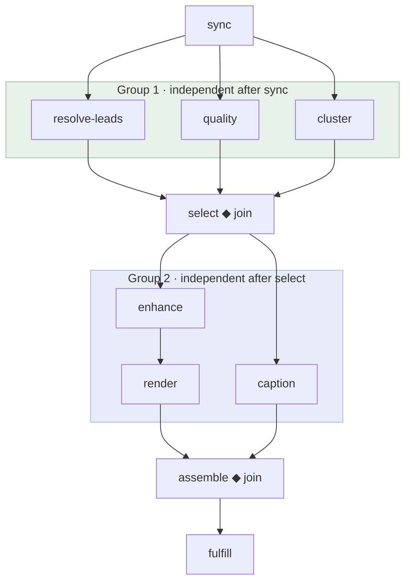

# Pipeline execution shape

Ten stages turn Immich assets into a photo book. `flow/_flow.py` (the sole
`@flow`, produced by `Pipeline.flow()`) runs them as a **DAG**: a sequential spine
with two concurrent fan-out groups. Each stage **is its own Prefect task** via the
`TaskUnit` base — sequential stages run inline and reuse the flow's shared session;
fan-out stages `.submit()` to worker threads, each opening its own pooled session
(see [quality practices](/process/quality-practices.md) §1.5–1.6 for the mechanism).

> Companion visual (self-contained): `knowledge/foundations/pipeline-execution.html` —
> the same graph, styled for light/dark.

## The dependency graph

Solid edges are hard data dependencies. The two shaded groups are clean
parallelisation cut points — each stage in a group reads only `sync`/`select`
output and writes disjoint state.



**Critical path:** `sync → (cluster ‖ quality ‖ leads) → select → enhance → render
→ assemble → fulfill`. The longest branch of each fan-out sets the floor: `quality`
in group 1 (per-photo ML), the `enhance→render` chain in group 2 (render shells to
`darktable-cli`) — so `caption` runs entirely in its shadow, for free wall-clock.

## Where the parallelism is

| Group | Stages | Why independent | Joins at |
|---|---|---|---|
| **After `sync`** | [`resolve-leads`](/build/enrichment.md) ‖ [`quality`](/stages/quality.md) ‖ [`cluster`](/stages/cluster.md) | Each reads only `Photo` rows, writes disjoint state (`Person.is_lead`; scores/`clip_embedding`; segment/scene). No stage reads another's output. | [`select`](/stages/select.md) |
| **After `select`** | [`enhance`](/stages/enhance.md)→[`render`](/stages/render.md) ‖ [`caption`](/stages/caption.md) | Both consume the `selected=True` set; render makes JPEGs, caption makes text. `enhance→render` is a hard chain (render needs enhance's XMP sidecars). | [`assemble`](/stages/assemble.md) |

True chains (not parallelisable): `sync → everything`, the group-1 trio → `select`,
`enhance → render`, `assemble → fulfill`.

## Stage responsibilities

Every stage is `album_id`-scoped and reads from **our** DB; Immich is touched only
at `sync` (the boundary — see [architecture](/foundations/architecture.md)).

| Stage | Group | Responsibility | Writes |
|---|---|---|---|
| [`sync`](/stages/sync.md) | seq | **The boundary.** Pull the album's assets from Immich, keyed on asset id. Idempotent. | `Photo` |
| [`resolve-leads`](/build/enrichment.md) | 1 | Resolve `album.yml` priority subjects to Immich people; mark lead. | `Person.is_lead` |
| [`quality`](/stages/quality.md) | 1 | Score blur (real) + aesthetic + CLIP embedding (ML, deferred). | `Photo` scores |
| [`cluster`](/stages/cluster.md) | 1 | Assign each photo to a segment (timestamp) + scene (gap detection). | `segment_id`, `Scene` |
| [`select`](/stages/select.md) | seq | Diversity- + people-aware best-of-scene via MMR; near-dup suppression. | `Photo.selected` |
| [`enhance`](/stages/enhance.md) | 2 | Estimate bounded tone deltas; classical code writes XMP sidecars. | XMP sidecars |
| [`render`](/stages/render.md) | 2 | Batch `darktable-cli` over the sidecars → corrected JPEGs. | JPEG files |
| [`caption`](/stages/caption.md) | 2 | Every selected photo gets a caption (shared analysis call). | `Photo.caption` |
| [`assemble`](/stages/assemble.md) | seq | Jinja2 grid layouts → print-ready PDF via WeasyPrint. | book PDF |
| [`fulfill`](/stages/fulfill.md) | seq | Deliver via a pluggable `Printer` — HTML (default) or Lulu. | deliverable |

## Session ownership & invariants

A shared SQLAlchemy `Session` isn't thread-safe, so a fan-out stage takes a
`session_factory` (never a live `Session`) and opens its session **inside `run`**,
on its worker thread. The four sequential stages (`sync`, `select`, `assemble`,
`fulfill`) reuse the flow's shared session via a `reuse()` factory; the six grouped
stages own theirs. The flow body is two `.submit()`/`.result()` fences (group 1
joins at `select`; group 2 runs `enhance`, then `render`‖`caption`, joins at
`assemble`).

```python
shared = reuse(db_session)                                    # sequential stages reuse; run() commits, never closes
SyncStage(client, album_id, shared).run_as_task()             # inline

g1 = [LeadFaceResolver(...).to_task().submit(),
      QualityStage(...).to_task().submit(),
      ClusterStage(album_id, session_factory).to_task().submit()]
for f in g1: f.result()                                       # join: blocks + re-raises

db_session.expire_all()                                       # drop stale identity-map state from before fan-out
SelectStage(similarity, album_id, shared).run_as_task()

EnhanceStage(...).to_task().submit().result()                 # join enhance BEFORE submitting render/caption
render_f, caption_f = RenderStage(...).to_task().submit(), CaptionStage(...).to_task().submit()
for f in (render_f, caption_f): f.result()

AssembleStage(...).run_as_task(); FulfillStage(...).run_as_task()
```

The invariants (why the fences are placed as they are):

| Invariant | Detail |
|---|---|
| **Commit before fan-out** | Commit the shared session *before* each group so worker threads read committed rows. |
| **`expire_all()` after join** | So `select`/`assemble` re-read what the workers wrote (fresh `is_lead`, scores, selections). |
| **Join `enhance` before render/caption submit** | Keeps them strictly after `enhance`'s commit — a real `enhance` failure surfaces its own error, not a masked `UpstreamTaskError`, and avoids the `PhotoAnalyzer.ensure` idempotency race a fully-concurrent `enhance`‖`caption` had. |
| **Failure isolation** | Each task's own `with session_factory()` rolls back independently; `.result()` re-raises and aborts before the join. |
| **Connection pool** | Concurrency peaks at 3 (group 1); default `QueuePool` (5 + 10 overflow) suffices. Size `pool_size` only if a stage's *internal* per-photo loop later becomes Prefect-level fan-out. |
| **Tests** | The in-memory SQLite test session isn't thread-shareable; unit tests inject a `session_factory` of independent doubles. Real concurrency is covered by the [pgvector TestContainers suite](/build/testcontainers.md). |
