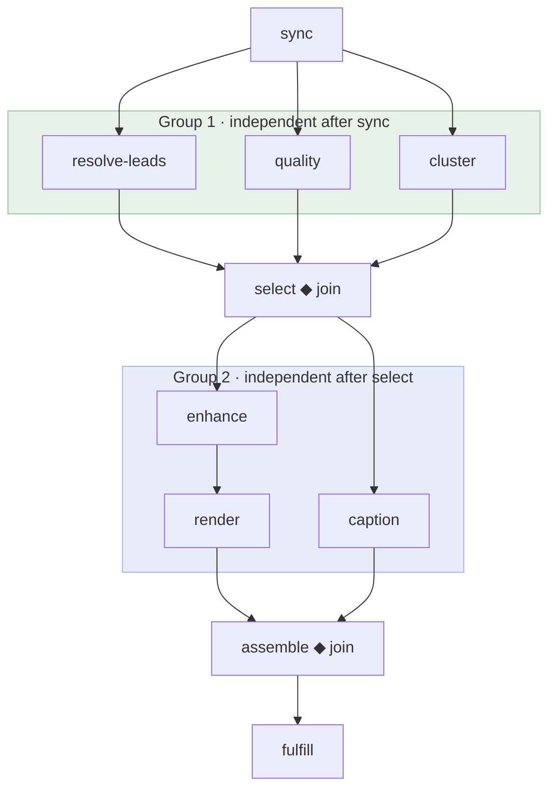

# Pipeline execution shape

> **Status (updated 2026-07-17): implemented, then restructured.** The fan-out
> DAG that the sections below propose as a "change"/"sketch" was applied in build
> [step 25](/build/progress.md) and later restructured by a refactor. In the
> current code each stage **is its own Prefect task** via the `TaskUnit` base
> (`task_name` + `to_task()`/`run_as_task()`) — there are no module-level `@task`
> functions and no `flow/_tasks.py`; a stage opens and commits its own session
> inside `run` (sequential stages reuse the flow's shared session via a `reuse()`
> factory, fan-out stages open their own). The single `@flow` is produced by the
> **class-based `Pipeline.flow()`** factory in `flow/_flow.py`. Everywhere below, read
> **`flow.py`** as **`flow/_flow.py`**, and the "as it runs today — a linear
> chain" reading as the *original* design the DAG replaced. The
> dependency-graph analysis and the two invariants (commit-before-fan-out,
> `expire_all()`-after-join) remain exactly current.

Eleven stages turn Immich assets into a photo book. Originally [`flow/_flow.py`](/foundations/architecture.md)
ran them **strictly sequentially** on one shared DB `Session`, committed after
each stage. But the underlying data dependencies form a **DAG** with two
fan-out groups that run concurrently. This doc is the map: the shape, why
it originally ran as a line, and the change that parallelised it.

> Companion visual (self-contained, no external deps):
> `knowledge/foundations/pipeline-execution.html` — the same graph hand-drawn, plus the code
> sketch, styled for both light and dark themes.

## The dependency graph

Solid edges are hard data dependencies. The two shaded groups run independently
of themselves internally — each is a clean parallelisation cut point.



## Two readings

- **As it runs today — a linear chain.** One shared `Session`, committed after
  every stage ([`flow.py`](/foundations/architecture.md), the sole `@flow`). Simple,
  resumable, one DB connection. Each stage already isolates its own per-photo
  failures (try/except+continue over its own loop), so no Prefect-level fan-out
  was needed to be correct — a deliberate choice documented in `flow.py`'s
  module docstring.
- **As data flows — a diamond DAG.** Three stages need only `sync`; two
  branches feed `assemble`. Strip away the "one session, one thread"
  implementation choice and two independent fan-out groups appear, each closing
  on a single join.

## Where the parallelism is

| Group | Stages | Why independent | Joins at |
|---|---|---|---|
| **After `sync`** | [`resolve-leads`](/build/enrichment.md) ‖ [`quality`](/stages/quality.md) ‖ [`cluster`](/stages/cluster.md) | Each reads only `Photo` rows and writes disjoint state — `Person.is_lead`; blur/aesthetic/`clip_embedding`; segment/scene assignment. No stage reads another's output. | [`select`](/stages/select.md) |
| **After `select`** | [`enhance`](/stages/enhance.md)→[`render`](/stages/render.md) ‖ [`caption`](/stages/caption.md) | Both consume the `selected=True` set; render makes JPEGs, caption makes text, neither reads the other. `enhance→render` is itself a hard chain (render needs enhance's XMP sidecars). | [`assemble`](/stages/assemble.md) |

**True chains (not parallelisable):** `sync → everything`, the group-1 trio →
`select`, `enhance → render`, and `assemble → fulfill`.

### Critical path

```
sync → ( cluster ‖ quality ‖ leads ) → select → enhance → render → assemble → fulfill
```

The longest branch of each fan-out sets the floor. In group 1 that's `quality`
(per-photo ML scoring). In group 2 it's the `enhance→render` chain — render
shells out to `darktable-cli` — so `caption` runs entirely in its shadow, for
free wall-clock time.

## Stage responsibilities

Every stage is `album_id`-scoped and reads from **our** DB; Immich is touched
only at `sync` (the boundary — see [architecture](/foundations/architecture.md)).

| Stage | Group | Responsibility | Writes |
|---|---|---|---|
| [`sync`](/stages/sync.md) | seq | **The boundary.** Pull the album's assets from Immich, keyed on asset id. Idempotent. | `Photo` |
| [`resolve-leads`](/build/enrichment.md) | 1 | Resolve `album.yml` priority subjects to Immich people; mark them lead. | `Person.is_lead` |
| [`quality`](/stages/quality.md) | 1 | Score blur (Laplacian, real) + aesthetic + CLIP embedding (ML, deferred). | `Photo` scores |
| [`cluster`](/stages/cluster.md) | 1 | Assign each photo to a segment (by timestamp) and a scene (gap detection). | `segment_id`, `Scene` |
| [`select`](/stages/select.md) | seq | Diversity- + people-aware best-of-scene via MMR; near-dup suppression via embeddings. | `Photo.selected` |
| [`enhance`](/stages/enhance.md) | 2 | Vision call estimates bounded tone deltas; classical code writes XMP sidecars. | XMP sidecars |
| [`render`](/stages/render.md) | 2 | Batch `darktable-cli` over the sidecars → corrected JPEGs. | JPEG files |
| [`caption`](/stages/caption.md) | 2 | Guarantee every selected photo has a caption (same shared analysis call). | `Photo.caption` |
| [`assemble`](/stages/assemble.md) | seq | Lay photos into Jinja2 grid templates; render a print-ready PDF via WeasyPrint. | book PDF |
| [`fulfill`](/stages/fulfill.md) | seq | Deliver via a pluggable `Printer` — HTML book (default) or Lulu order. | deliverable |

## The change

One structural idea — an **own session per concurrent task** — plus a couple of
`submit()` / `result()` fences. This began as a sketch; it is now implemented in
`flow/_flow.py` (via the `Pipeline` class) — see the status note at the top.

### 1 · Session ownership

A shared SQLAlchemy `Session` isn't thread-safe, so a stage takes a `session_factory`
(never a live `Session`) and opens the session **inside `run`**, on whichever thread
runs it. A stage carrying no live session is what makes the same instance safe to
`.submit()` to a worker thread:

```python
SessionFactory = Callable[[], AbstractContextManager[Session]]

# sequential — reuses the flow's shared session (a `reuse()` singleton factory that
# yields it without closing) and runs inline; run() commits the shared session
SyncStage(client, album_id, reuse(db_session)).run_as_task()

# fan-out — its OWN pooled connection per worker thread; run() opens it, commits,
# and closes it. No builder needed: the unit holds only the factory.
QualityStage(client, aesthetic, album_id, session_factory, embedder=embedder).to_task().submit()
```

The four sequential stages (`sync`, `select`, `assemble`, `fulfill`) reuse the
shared session; the six grouped stages own theirs.

### 2 · The flow body

`.submit()` schedules on Prefect 3's default `ThreadPoolTaskRunner`; `.result()`
blocks and re-raises. Joining `enhance`'s future *before* `render`/`caption` are
even submitted keeps them strictly after `enhance`'s commit (a real `enhance`
failure then surfaces its own error, not a masked `UpstreamTaskError`).

```python
shared = reuse(db_session)          # sequential stages reuse this; run() commits, never closes

SyncStage(client, album_id, shared).run_as_task()   # inline; run() commits the shared session

# ── group 1: independent after sync ──
g1 = [
    LeadFaceResolver(client, album_id, config, album_dir, session_factory).to_task().submit(),
    QualityStage(client, aesthetic, album_id, session_factory, embedder=e).to_task().submit(),
    ClusterStage(album_id, session_factory).to_task().submit(),
]
for f in g1:
    f.result()                      # join: blocks + re-raises any stage error

db_session.expire_all()             # drop stale identity-map state from before fan-out
SelectStage(similarity, album_id, shared).run_as_task()

# ── group 2: enhance first, then render‖caption ──
EnhanceStage(analyzer, client, album_id, session_factory).to_task().submit().result()
render_f  = RenderStage(client, renderer, album_id, session_factory).to_task().submit()
caption_f = CaptionStage(analyzer, album_id, session_factory).to_task().submit()
for f in (render_f, caption_f):
    f.result()

AssembleStage(albums_dir, album_id, shared).run_as_task()
FulfillStage(printer, album_id, shared).run_as_task()
```

## What it costs

The task graph already permits this — these are the real edges to mind.

| Concern | Detail |
|---|---|
| **Connection pool** | Concurrency peaks at 3 (group 1). Default `QueuePool` is 5 + 10 overflow = 15, so no change needed now. Size `pool_size` only if a stage's *internal* per-photo loop later becomes Prefect-level fan-out — the standing warning in [`build-order`](/build/build-order.md) step 14 and `flow.py`'s docstring. |
| **Failure isolation** | Each task's own `with session_factory()` rolls back independently — one group-1 failure no longer poisons a shared transaction, and `.result()` still surfaces it and aborts before `select`. |
| **Read-after-write** | Commit the shared session *before* each fan-out so worker threads read committed rows; `expire_all()` after the join so `select`/`assemble` re-read what the workers wrote (fresh `is_lead`, scores, selections). |
| **Tests** | The in-memory SQLite test session isn't concurrency-safe and can't be shared across threads. Unit tests for ordering/wiring inject a `session_factory` returning independent doubles (or run the runner serially); real concurrency stays covered by the [pgvector TestContainers suite](/build/testcontainers.md). |

**Net:** the whole change is *own session per concurrent task + two
`submit`/`result` fences*. The real wall-clock win lands in group 2, where
`caption` disappears entirely into the shadow of the `enhance→render` chain.
